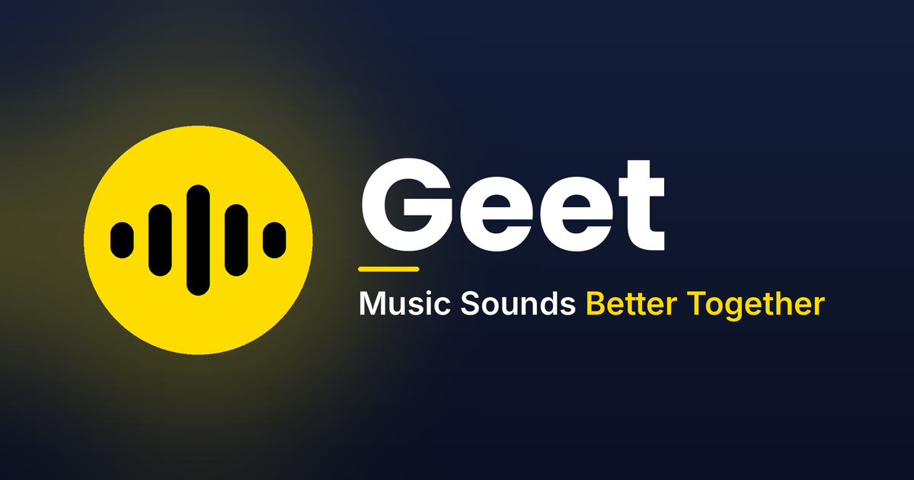

<div align="center">
  

  <h1>Geet</h1>

  **Music sounds better together.**

  A free, mobile-first music app built around sharing songs and listening with friends.

  [Listen at listengeet.com](https://listengeet.com) · [Explore the architecture](docs/12-architecture-hosting-dns.md) · [Contribute](CONTRIBUTING.md)
</div>

---

## About

Geet is an independent music project for sharing songs with the people you care about. The product is designed for a Punjabi, Hindi and English catalogue, with a phone-first interface and an installable web app.

The public site is live at [listengeet.com](https://listengeet.com). This repository is being built in phases: the current web home page is the foundation placeholder, and the catalogue and listening features described in the product brief are planned work. See [`phases/`](phases/) for the implementation sequence and [`docs/00-product-brief.md`](docs/00-product-brief.md) for the product scope.

## Product direction

- **Listen together:** synchronized listening sessions, shared queues and song sharing.
- **Make it yours:** favourites, playlists, listening history and daily mixes.
- **Keep music close:** an installable PWA designed for mobile, with offline listening in the product plan.
- **Built for its catalogue:** Punjabi, Hindi and English are the initial focus.

These describe the product direction; check the phase documents for what is implemented today.

## Project structure

| Path | Purpose |
| --- | --- |
| [`web/`](web/) | Next.js progressive web app |
| [`api/`](api/) | Next.js API service |
| [`worker/`](worker/) | Audio transcoding worker |
| [`packages/shared/`](packages/shared/) | Shared types and server helpers |
| [`supabase/`](supabase/) | Database migrations and SQL tests |
| [`docs/`](docs/) | Product, design, architecture and API documentation |
| [`phases/`](phases/) | Build plan and phase notes |

## Run locally

**Requirements:** Node.js `22.12` or newer and npm. The repository pins the Node major in [`.nvmrc`](.nvmrc).

```sh
nvm use
npm install
cp .env.example web/.env.local
```

Review [`.env.example`](.env.example) and the [hosting and environment guide](docs/12-architecture-hosting-dns.md) before starting the services. The API also needs `NEXT_PUBLIC_APP_URL` and `CORS_ORIGINS` in `api/.env.local`.

In separate terminals:

```sh
npm run dev -w web   # http://localhost:3000
npm run dev -w api   # http://localhost:3001/api/health
```

## Development commands

```sh
npm run typecheck
npm run lint
npm run format:check
npm test
npm run test:sql
npm run build
```

SQL integration checks require a local PostgreSQL service. Some scripts are scaffolding while their corresponding build phases are pending; consult [`phases/`](phases/) before relying on them.

## Documentation

- [Product brief](docs/00-product-brief.md)
- [Brand and design system](docs/01-brand-and-design-system.md)
- [Architecture and hosting](docs/12-architecture-hosting-dns.md)
- [Data model and row-level security](docs/13-data-model-rls.md)
- [API reference](docs/15-api-reference.md)
- [CI and open-source setup](docs/16-ci-and-open-source.md)
- [Build order](docs/17-build-order-for-claude-code.md)
- [Accessibility, performance and SEO](docs/18-accessibility-performance-seo.md)

## Contributing

Issues and pull requests are welcome. Please read [CONTRIBUTING.md](CONTRIBUTING.md) before opening a pull request. For security concerns, use the private reporting instructions in [SECURITY.md](SECURITY.md).

## License and brand

The source code is licensed under [AGPL-3.0-only](LICENSE). The Geet name, logo, wordmark and specified media assets are reserved and are not covered by that license; see [TRADEMARKS.md](TRADEMARKS.md) before redistributing or deploying a fork.

---

<div align="center">
  <a href="https://listengeet.com">listengeet.com</a>
</div>
